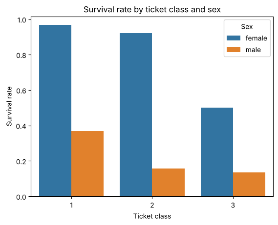
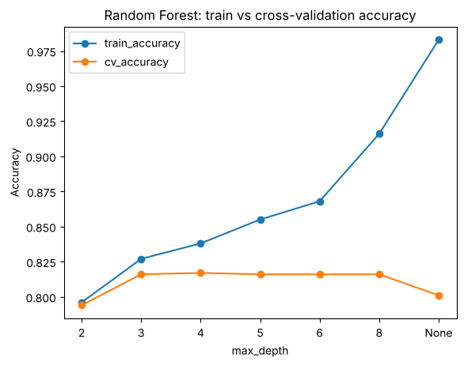
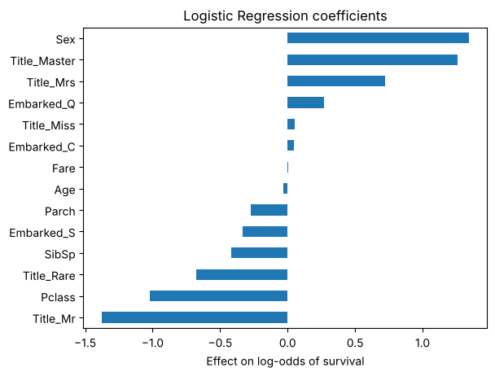

# Titanic Survival Prediction

An end-to-end machine learning project that predicts which Titanic passengers survived, from exploratory analysis to a final evaluation on a held-out test set.

**Final result:** 83.8% accuracy on held-out test data, against a 61.5% majority-class baseline.



## What this project covers

| Step | What was done |
|---|---|
| Exploratory analysis | Survival rates by sex and ticket class; majority-class baseline |
| Data cleaning | Dropped `Cabin` (77% missing); median imputation for `Age`; mode imputation for `Embarked` |
| Feature engineering | Extracted passenger title (`Mr`, `Mrs`, `Miss`, `Master`, `Rare`) from names |
| Encoding | Binary encoding for `Sex`; one-hot encoding for `Embarked` and `Title` |
| Model selection | Logistic Regression, Random Forest and XGBoost compared with 5-fold cross-validation on the training set only |
| Overfitting analysis | Train vs cross-validation accuracy across Random Forest tree depths |
| Final evaluation | One evaluation on a stratified 20% held-out test set: accuracy, precision/recall, confusion matrix |

## Results

Cross-validation accuracy on the training set (5 folds):

| Model | Base features | + Title feature |
|---|---|---|
| Logistic Regression | 0.795 | **0.820** |
| Random Forest (default depth) | 0.796 | 0.801 |
| XGBoost (default) | 0.799 | 0.795 |

Final model: **Logistic Regression with the title feature**, evaluated once on the held-out test set:

| Metric | Value |
|---|---|
| Accuracy | 0.838 |
| Precision (survived) | 0.82 |
| Recall (survived) | 0.74 |

## Key findings

**1. Feature engineering beat hyperparameter tuning.** The `Master` title identifies boys (57.5% survival vs 15.7% for adult men), which `Sex` and a heavily imputed `Age` cannot capture. It added 2.5 points to Logistic Regression, more than any hyperparameter change added to the tree models.

**2. A feature's value depends on the model.** Tree models gained little from the title because they can already combine other columns (e.g. male + travelling with parents) to approximate it. Logistic Regression treats features independently and needs the information made explicit.

**3. Unrestricted trees overfit.** Random Forest with no depth limit reached 98% training accuracy but only 80% in cross-validation. Depths 3–8 gave the best cross-validation accuracy (~81.6%), and shallower trees keep training and validation accuracy close.



**4. Simpler won the tie.** Logistic Regression with the title feature matched the tuned Random Forest within cross-validation noise, so the simpler, more interpretable model was chosen. Its coefficients confirm the "women and children first" pattern:



## Run it

```bash
python -m venv .venv
source .venv/bin/activate
pip install -r requirements.txt
jupyter notebook notebooks/titanic_survival.ipynb
```

The dataset is downloaded automatically from [datasciencedojo/datasets](https://github.com/datasciencedojo/datasets/blob/master/titanic.csv).

## Tech stack

Python, pandas, scikit-learn, XGBoost, Matplotlib, seaborn, Jupyter
